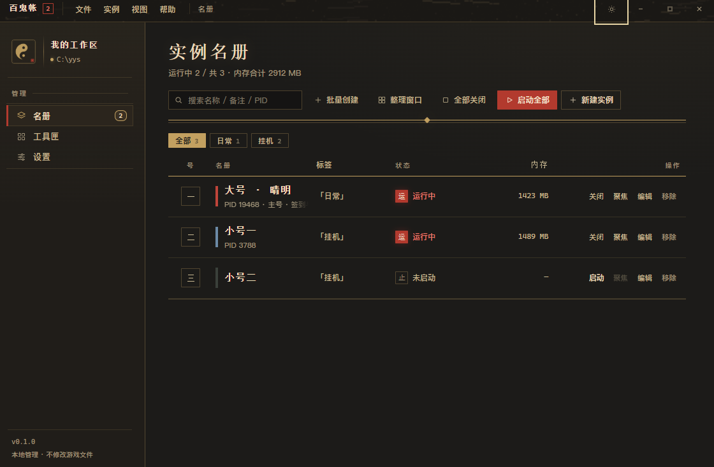
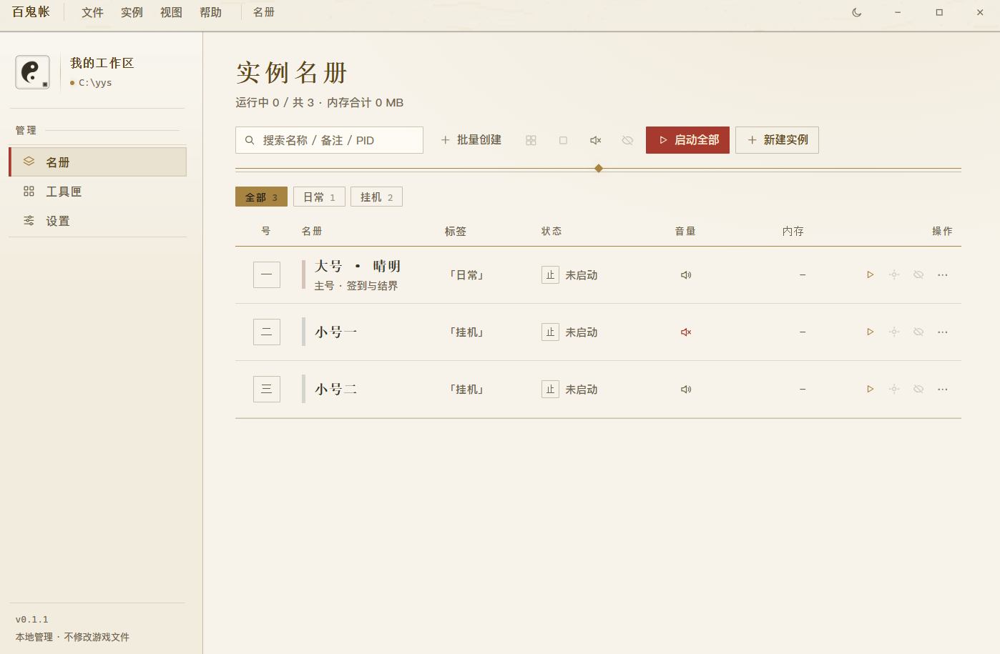
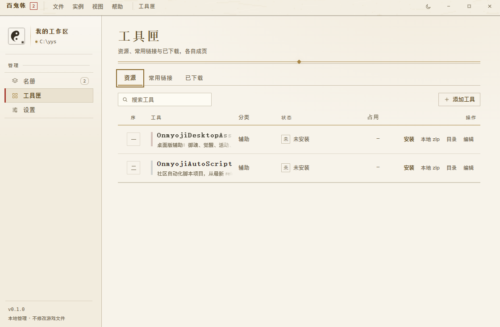
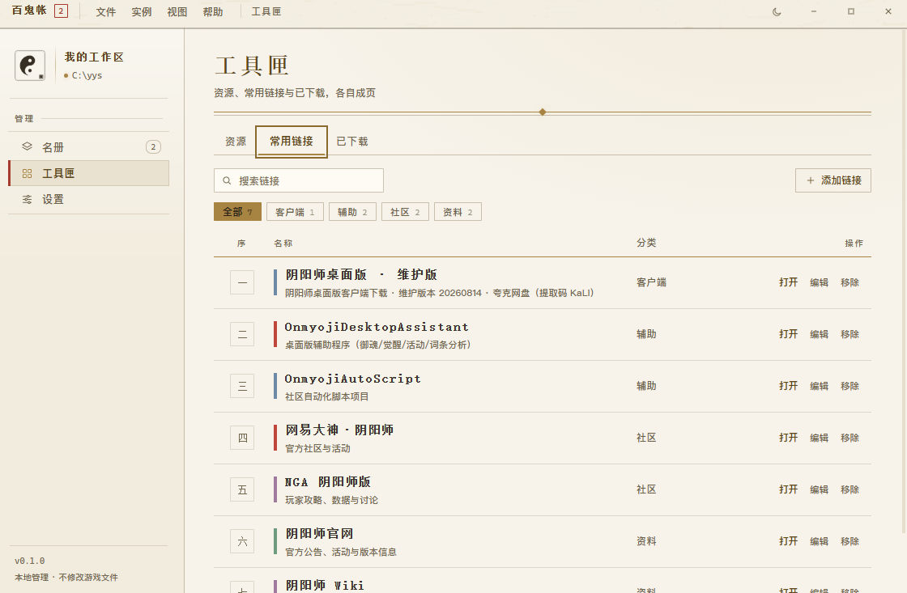
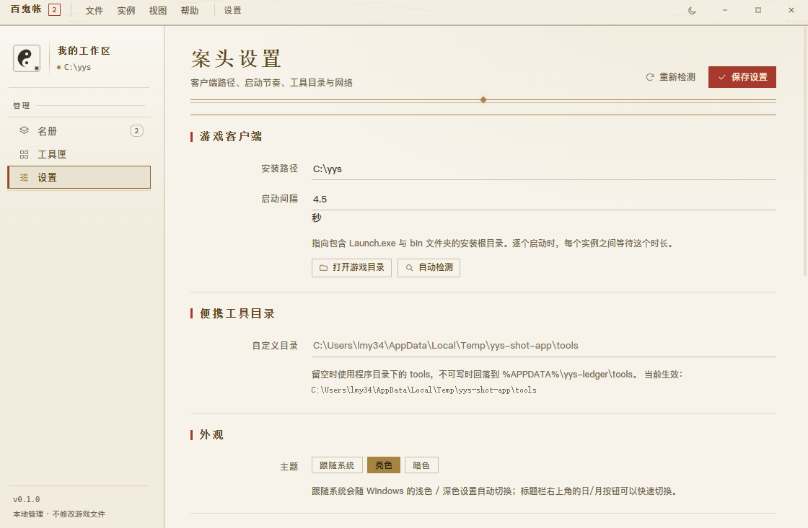
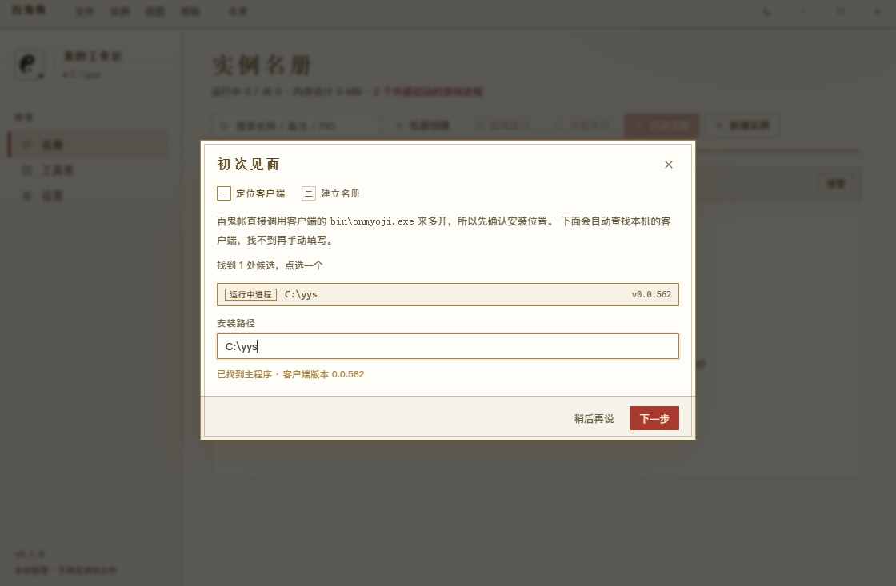

# 百鬼帐 · yys-ledger

阴阳师官方 PC 版的桌面名册：多开管理、实例监控与崩溃自动拉起、窗口整理，外加一个便携工具箱。

> 与网易、阴阳师官方无关，不保存账号密码、不注入游戏进程、不修改游戏文件。



| 亮色主题 | 工具匣 |
| --- | --- |
|  |  |
| **常用链接** | **案头设置** |
|  |  |

**首次设置向导**



## 下载

- 最新版本：[Releases](../../releases/latest)
- 安装版 `yys-ledger-0.1.1-setup.exe`：默认装到 `%LOCALAPPDATA%\yys-ledger`，缺少 WebView2 时自动下载运行时
- 便携版 `yys-ledger-0.1.1-portable.zip`：解压即用，配置与日志都在程序目录的 `data/`

## 功能

### 名册与多开

- 一行一个号，序号本身就是勾选印章（一/二/三），行尾常驻操作
- 批量创建：数量、前缀、起始编号、标签、色条；创建与编辑都会挡重名
- 每个实例显示 PID、进程树内存、响应状态（运 / 滞 / 止三枚状态印）、标签与色条；未运行时色条降饱和
- 标签可点选筛选并显示数量，与搜索叠加；搜索覆盖名称 / 备注 / PID / 标签
- 一键启动全部、全部关闭、窗口网格平铺（按 16:9 计算，跟随第一个窗口所在显示器）
- **隐藏 / 显示窗口**：单行或批量隐藏游戏窗口，隐藏后状态印显示「隐」；聚焦会自动恢复显示；工具栏可隐藏/显示全部
- **逐实例音量**：每行音量列可调 0–100% 或静音，选中栏可批量设置；工具栏「静音全部 / 恢复声音」；音量按实例持久化
- **操作收纳**：行内只保留启动/关闭、聚焦、隐藏/显示三个图标，编辑、复制名称、自动重启、移除收进「更多」菜单；整理窗口、全部关闭、静音、隐藏全部在工具栏以图标呈现
- **按标签启停**：点选标签后可直接「启动此标签 / 关闭此标签」
- 快捷键：`Ctrl+N` 新建、`Ctrl+B` 批量创建、`F5` 刷新状态、`Ctrl+Shift+M` 全部静音 / 恢复

### 崩溃自动拉起

- 每个实例可单独开启「崩溃后自动重启」，右键菜单也能快速开关
- 意外退出后按 5 秒 → 15 秒 → 1 分钟 → 3 分钟递增重试；手动关闭不触发
- 监控在 Rust 后台线程里跑，窗口收进托盘、前端定时器被节流都不影响
- PID 与进程创建时间写入 `%APPDATA%\yys-ledger\runtime.json`，应用重启后据此认领仍在运行的游戏；创建时间对不上（PID 被复用）则忽略
- 检测到不是本工具启动的游戏进程时，名册顶部提供「接管」，把它们分配到空闲实例

### 工具匣

- 三个子页：**资源**（可下载工具）/ **常用链接** / **已下载**，统一为「标签页 → 搜索/操作栏 → 列表」
- 资源页：GitHub release 自动下载 zip、本地 zip 安装、编辑定义、移除；下载可取消，连接 15 秒超时、整体 30 分钟上限
- 解压先写临时目录，成功后才替换旧版本；每个工具带 `.yys-ledger.json` 记录版本与安装时间
- 已下载页支持按安装时间 / 名称 / 占用排序，并可「检查更新」，有新版本时一键更新
- 常用链接：客户端 / 辅助 / 社区 / 资料四类，分类显示数量，内置「阴阳师桌面版 · 维护版」下载入口

### 窗口与托盘

- 窗口尺寸、位置、最大化状态会被记住，下次启动恢复，并夹到当前显示器范围内
- 托盘常驻：关闭窗口收进托盘并提示一次；托盘菜单可显示主窗口、直接聚焦任一运行中的实例、退出；双击托盘图标回到窗口
- 单实例保护：再次启动只会唤起已有窗口，不会出现两个进程互相覆盖配置
- 主题跟随系统 / 亮色 / 暗色三态，标题栏日/月按钮快速切换；启动前由 `theme-init.js` 预先上色，避免闪白

### 诊断

- 启动、安装、崩溃重启写入 `%APPDATA%\yys-ledger\logs\app.log`，超过 2MB 轮转
- 设置页可一键打开日志目录，并显示当前数据目录与是否处于便携模式
- 设置采用「写临时文件 → 备份 → 替换」，断电或崩溃不会把配置截断

## 客户端目录探测

官方安装器不写卸载注册表项，所以不依赖注册表，按可靠度依次尝试：

1. **运行中的进程**：正在跑的 `onmyoji.exe` 的镜像路径
2. **快捷方式**：桌面、公共桌面、开始菜单里的 `.lnk`，解析 Shell Link 中的本地目标路径
3. **常见路径**：各盘符的 `yys`、`Onmyoji`、`网易\阴阳师`、`Program Files\Onmyoji` 等
4. **磁盘浅层扫描**：各固定盘根目录及 `Games`、`Program Files`、`Software` 等常见父目录的一层子目录

每条候选都要求包含 `bin\onmyoji.exe` 才会被采纳，并按路径去重。首次设置向导与设置页的「自动检测」用的是同一套逻辑。

## 多开原理（实测）

单实例限制在官方启动器 `Launch.exe`：游戏运行中再启动 Launch.exe 会直接杀掉现有实例并接管。

本工具**直接启动 `bin\onmyoji.exe`**，工作目录设为安装根目录：

```
C:\yys\bin\onmyoji.exe      cwd = C:\yys
```

实测同目录 2 开、3 开稳定，每个实例约 810–840 MB。

## 技术栈

- Tauri 2 + Rust（Win32 进程/窗口操作、下载与解压、本地日志）
- React 19 + TypeScript + Vite，纯 CSS，无 UI 框架
- 双主题：暗色「夜墨金」与亮色「宣纸金」，共用朱、金、墨一套语义色；标题用宋体，数据用等宽字体

## 素材与图标

纸纹、墨纹、太极印章图标均由项目自绘或由 [`scripts/make-textures.py`](scripts/make-textures.py) 程序生成，不含《阴阳师》官方美术素材。

图标有两版：浅色主题用墨色单色版，暗色主题用金色朱印版；侧边栏、favicon、窗口与托盘图标都会跟随主题切换。可执行文件与安装包使用暗色版作为固定品牌图标。

游戏名称、相关商标归网易所有，本项目与官方无关。

## 工具箱网络说明

默认工具从 GitHub release 下载。直连 GitHub 超时时可以：

1. 在「设置 → 网络与下载」填写本地代理（如 `http://127.0.0.1:7890`）；或
2. 手动下载 portable zip，在工具上点「本地 zip」导入。

GitHub 未登录的 API 每小时限 60 次，频繁「检查更新」可能遇到限流。

工具目录默认是 `程序目录/tools`，不可写时回落到 `%APPDATA%\yys-ledger\tools`。

> 便携版工具的可用性、授权与账号风险由使用者自行判断；本工具只负责下载、解压和启动。

## 开发

```bash
npm install
npm run tauri dev
```

首次编译 Rust 依赖需要几分钟。

重新生成图标与纹理：

```bash
python scripts/make-icon.py       # 需要 Pillow，生成太极印章图标源
npx tauri icon src-tauri/app-icon.png
python scripts/make-textures.py   # 生成纸纹 / 墨纹
```

## 构建

```bash
npm run tauri build               # 安装包
python scripts/package-portable.py  # 便携版（需先构建 release）
```

- 安装包：`src-tauri/target/release/bundle/nsis/yys-ledger_0.1.1_x64-setup.exe`（默认装到 `%LOCALAPPDATA%\yys-ledger`）
- 便携版：`release/yys-ledger/`，以及 `yys-ledger-0.1.1-portable.zip`（解压得到同名目录）

便携模式的判定：exe 同目录存在 `data` 文件夹或 `yys-ledger.portable` 标记文件时，配置、日志、PID、窗口状态全部写到 `data` 下；否则使用 `%APPDATA%\yys-ledger`。拷贝整个文件夹即可保留全部设置。

便携版依赖系统已有的 WebView2 运行时（Windows 10/11 通常自带），且不能放在 Program Files 这类只读目录。

## 配置文件

`%APPDATA%\yys-ledger\`

| 文件 | 内容 |
| --- | --- |
| `config.json` | 名册、标签、工具与链接定义、主题、代理 |
| `config.json.bak` | 上一次成功写入的配置备份 |
| `runtime.json` | 实例 PID 与进程创建时间 |
| `window.json` | 窗口尺寸、位置、最大化状态 |
| `logs/app.log` | 运行日志（超过 2MB 轮转为 `app.1.log`） |

从旧版 `yys-hub` 升级时，首次启动会把旧目录里的 `config.json`、备份、`runtime.json`、`window.json` 复制到新目录，旧文件保留不删。

## 注意事项

- 不要用桌面快捷方式（Launch.exe）启动游戏，它会把工具管理的实例全部结束
- 游戏更新仍需官方启动器完成，更新前请先关闭所有实例
- 工具不保存账号密码、不注入游戏进程、不修改游戏文件
- 单实例运行，重复启动会唤起已有窗口

## 目录

```
src/
  components/TitleBar.tsx     自定义标题栏与菜单
  components/Onboarding.tsx   首次设置向导
  components/Truncate.tsx     单行截断 + 悬停全文
  pages/Instances.tsx         实例名册、批量创建与批量操作
  pages/Tools.tsx             资源 / 常用链接 / 已下载
  pages/Settings.tsx          客户端、工具目录、代理、诊断
  styles/                     base / shell / roster / forms
scripts/
  make-icon.py                生成可执行文件用的太极印章图标
  make-theme-icons.py         生成随主题切换的墨色 / 金色透明图标
  make-textures.py            生成纸纹与墨纹
  check-versions.mjs          构建前校验三处版本号一致
  package-portable.py         生成便携版文件夹与 zip
src-tauri/src/
  config.rs                   配置、内置链接种子、原子写入、迁移
  detect.rs                   客户端目录多路探测
  tools.rs                    下载、解压、版本记录、更新检查
  procs.rs                    进程快照、进程树内存、进程创建时间
  audio.rs                    按进程设置 Windows 音频会话音量与静音
  win32.rs                    窗口枚举、聚焦、多屏平铺
  logs.rs                     本地日志
  lib.rs                      Tauri 命令、托盘、自动重启、单实例
screenshots/                 界面截图
release/                    构建产物（不提交）
```

## 开发说明

界面与代码在 Claude Code 的协助下完成，由项目维护者审阅与发布。

## 许可

代码以 MIT 许可发布，见 [LICENSE](LICENSE)。《阴阳师》名称、游戏内容及相关商标归网易所有。
